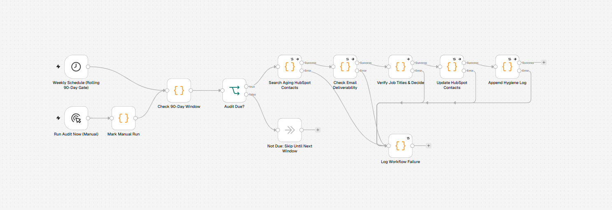

# n8n-hubspot-contact-role-decay-reverification-cron

A rolling quarterly list-hygiene audit for HubSpot. Every 90 days it finds **marketing contacts that have gone quiet for 180+ days** and re-checks two things: whether their **email is still deliverable**, and whether their **job title still matches my buyer criteria**. Invalid, bounced, risky, and unverified contacts are moved to a **quarantine status**, and can then be set to **Marketing Contact = false**. Each run appends a **summary log** with processed counts, status changes, and the estimated tier savings.

Contacts decay quietly: people change roles, mailboxes get deleted, and companies get acquired. I built this to run before campaign season, so the marketing-contact tier and the sending reputation aren't spent on addresses that bounce or people who are no longer buyers.

It ships as:

- **`workflow.json`**: an importable n8n workflow with schedule and manual triggers, labeled stage nodes, retries, and an error branch;
- a **Node.js CLI mirror** (`src/index.js`) running the same code, for cron or CI;
- **`src/core/`**: the shared logic. The workflow's Code nodes are generated from it, and the tests execute those nodes and compare them with the CLI.

Out of the box it reads nothing real and writes nothing: `DRY_RUN=true`, `SANDBOX_MODE=true`, `SMTP_CHECKER_PROVIDER=mock`, `LOG_TARGET=none`, and every credential is an uppercase placeholder.

---

## Contents

1. [How an audit runs](#how-an-audit-runs)
2. [Decision rules](#decision-rules)
3. [Prerequisites](#prerequisites)
4. [Environment variables (.env)](#environment-variables-env)
5. [HubSpot setup](#hubspot-setup)
6. [n8n node configuration](#n8n-node-configuration)
7. [Running the CLI mirror](#running-the-cli-mirror)
8. [Testing](#testing)
9. [Maintenance guidelines](#maintenance-guidelines)
10. [Troubleshooting](#troubleshooting)
11. [Repository layout](#repository-layout)

---
## Workflow architecture



## How an audit runs

```
 Weekly Schedule (Mon 06:00 UTC) ─┐
                                  ├─► Check 90-Day Window ─► Audit Due? ─ no ─► Not Due: Skip Until Next Window
 Run Audit Now (Manual) ─► Mark Manual Run (force) ─┘               │
                                                                 yes
                                                                  ▼
 Search Aging HubSpot Contacts ──► Check Email Deliverability ──► Verify Job Titles & Decide
   CRM search: marketing contacts,   local + HubSpot bounce          buyer-title match, decision matrix,
   lastmodifieddate and last sales   signals, then optional          exemptions, circuit breaker,
   activity older than 180 days;     ZeroBounce / NeverBounce /       savings estimate
   drop recently engaged and         custom API (rate-limited,              │
   recently re-checked contacts      capped per run)                        ▼
                                                                  Update HubSpot Contacts
                                                                    batch update, 100 per call
                                                                    DRY_RUN → intercepted
                                                                    SANDBOX_MODE → sandbox portal only
                                                                            │
                                                                            ▼
                                                                  Append Hygiene Log
                                                                    webhook (HMAC-signed) or Google Sheets row;
                                                                    stores lastAuditCompletedAt (live runs only)

 Any API stage fails 3 times ──► Log Workflow Failure (failure summary to the same log target)
```

**Why weekly plus a gate, instead of "every 90 days"?** n8n's schedule trigger has no "every 90 days" interval, and a fixed quarterly cron drifts away from when the audit actually last completed. The trigger fires weekly. `Check 90-Day Window` lets a run through only when `AUDIT_INTERVAL_DAYS` have passed since the last *completed live* audit (stored in workflow static data). A failed run, a dry run, or a circuit-breaker stop doesn't reset the window, so the next weekly tick tries again.

**Aging contacts** are found with the CRM search API (two filter groups ORed):

- `lastmodifieddate` older than the cutoff **and** `hs_last_sales_activity_timestamp` older than the cutoff (or never set),
- **and** `hs_marketable_status = true` (unless `ONLY_MARKETING_CONTACTS=false`).

Results are sorted oldest first and capped at `MAX_CONTACTS_PER_RUN`. Contacts with a recent email open, click, reply, note, or form conversion are dropped as engaged. Contacts this workflow re-checked within `RECHECK_AFTER_DAYS` are skipped, which saves verification credits.

**Deliverability**, in order:

1. **Local:** syntax, a disposable-domain list, role addresses (`info@`, `sales@`, `contact@` ...).
2. **HubSpot's own signals:** `hs_email_hard_bounce_reason_enum` and `hs_email_quarantined` mark a hard bounce.
3. **Verification API** (`SMTP_CHECKER_PROVIDER`): ZeroBounce, NeverBounce, or any HTTPS endpoint you control. Calls are spaced by `SMTP_CHECK_DELAY_MS` and capped by `MAX_VERIFICATIONS_PER_RUN`.

I don't open raw SMTP connections from n8n. Port 25 is blocked on most hosts, RCPT probing damages the probing IP's reputation, and catch-all corporate servers answer "OK" to everything. A verification provider does that work from infrastructure built for it.

**Mock provider** (default, offline): only reserved test domains get non-valid results (`*.invalid` → invalid, `catch-all.example` → catch-all, `unknown.example` → unknown, `spamtrap.example` → spam trap). Everything else is "valid". It exists for simulation and is refused when `DRY_RUN=false`.

---

## Decision rules

| Email result | Default hygiene status | Becomes non-marketing? |
| --- | --- | --- |
| hard bounce (HubSpot or provider) | `quarantine_bounced` | yes |
| invalid (syntax, provider) | `quarantine_invalid` | yes |
| disposable | `quarantine_disposable` | yes |
| spam trap / abuse / do-not-mail | `quarantine_risky` | yes |
| catch-all / unknown | `quarantine_unverified` (`UNVERIFIED_ACTION=flag` → `flagged_unverified`) | no (add it to `NON_MARKETING_STATUSES` to change that) |
| role address | `flagged_role_address` (`ROLE_ADDRESS_ACTION=quarantine` → `quarantine_risky`) | only if quarantined |
| valid + title outside criteria | `flagged_title_mismatch` (`TITLE_MISMATCH_ACTION=quarantine` → `quarantine_title_mismatch`) | no |
| valid + no title | `flagged_missing_title` (`MISSING_TITLE_ACTION=ignore` → `verified`) | no |
| valid + buyer title | `verified` | no |
| provider error / cap reached | *unchanged* (retried next run) | no |

Additional rules:

- **Exemptions.** Contacts in `EXEMPT_LIFECYCLE_STAGES` (default `customer,evangelist,opportunity`) are never quarantined. They get `exempt`, with the reason recorded, so someone can fix the address by hand.
- **Title matching** is case-insensitive and whole-word (`vp` doesn't match "MVP"). Exclusions win over targets ("Former Director" doesn't match).
- **Circuit breaker.** If more than `MAX_QUARANTINE_RATIO` (30%) of at least `CIRCUIT_BREAKER_MIN_SAMPLE` (20) checked contacts would be quarantined, **no updates are written**. The run is logged as `circuit_open`, because a provider misconfiguration looks exactly like a mass bounce.
- **Update cap.** At most `MAX_UPDATES_PER_RUN` contacts per run; the rest wait for the next window.

**What's written to each processed contact:** `list_hygiene_status`, `list_hygiene_reason`, `list_hygiene_email_status`, `list_hygiene_title_match`, and `list_hygiene_checked_at`.

**Marketing Contact = false.** With the default `MARKETING_STATUS_WRITE_MODE=quarantine_only`, I let a HubSpot workflow flip the status (see [HubSpot setup](#hubspot-setup), step 3). That's HubSpot's supported path for setting contacts to non-marketing, and it keeps the decision visible in HubSpot. `MARKETING_STATUS_WRITE_MODE=property` also sends `hs_marketable_status=false` in the batch update. If your portal rejects that property, the batch is retried without it and the run logs a warning.

**Savings estimate:** `non-marketing contacts ÷ 1000 × MARKETING_CONTACT_MONTHLY_COST_PER_1000`, reported monthly and annually. Set the rate from your own contract; the default `0` reports zero. HubSpot applies marketing-contact changes at its next tier update and sells tiers in blocks, so treat the number as a planning estimate.

---

## Prerequisites

- n8n 1.x (self-hosted or cloud) with environment access for Code nodes, **or** Node.js 20+ for the CLI. There are no npm dependencies.
- A HubSpot **developer test account or sandbox** for the first runs, with a Private App that has these scopes:
  - `crm.objects.contacts.read`, `crm.objects.contacts.write`
  - `crm.schemas.contacts.write` (only for the one-time property creation below)
- Marketing Hub, if you want the marketing-contact status workflow.
- Optional: a ZeroBounce or NeverBounce account (or your own verification endpoint); an HTTPS log webhook or a Google Sheet shared with a service account.
- A data processing agreement with your verification provider, because contact email addresses are sent to it.

---

## Environment variables (.env)

Copy `.env.example` to `.env` for the CLI, or set the same variables on the n8n host. Placeholders follow the `YOUR_..._HERE` pattern. Any variable still holding a placeholder counts as unset, and live mode refuses to start while required ones are unset.

| Variable | Default | Purpose |
| --- | --- | --- |
| `DRY_RUN` | `true` | Plan updates and build the log without writing to HubSpot |
| `SANDBOX_MODE` | `true` | Live writes only when the token's portal is a sandbox/developer test account, or equals `HUBSPOT_SANDBOX_PORTAL_ID` |
| `AUDIT_INTERVAL_DAYS` | `90` | Rolling window between completed live audits |
| `STALE_AFTER_DAYS` | `180` | Aging cutoff (minimum 30) |
| `RECHECK_AFTER_DAYS` | `90` | Skip contacts re-checked more recently than this |
| `MAX_CONTACTS_PER_RUN` | `2000` | Search cap (oldest first) |
| `ONLY_MARKETING_CONTACTS` | `true` | Limit the search to `hs_marketable_status = true` |
| `HUBSPOT_PRIVATE_APP_TOKEN` | `YOUR_HUBSPOT_PRIVATE_APP_TOKEN_HERE` | Private App token (placeholder = offline) |
| `HUBSPOT_SANDBOX_PORTAL_ID` | `YOUR_HUBSPOT_SANDBOX_PORTAL_ID_HERE` | Optional sandbox pin |
| `HUBSPOT_BASE_URL` / `HUBSPOT_SEARCH_DELAY_MS` | `https://api.hubapi.com` / `300` | API host / delay between search pages |
| `SMTP_CHECKER_PROVIDER` | `mock` | `mock`, `zerobounce`, `neverbounce`, `custom` |
| `SMTP_CHECKER_API_KEY` | `YOUR_SMTP_CHECKER_API_KEY_HERE` | Provider key (custom: sent as `Authorization: Bearer`) |
| `SMTP_CHECKER_URL` | `YOUR_SMTP_CHECKER_URL_HERE` | Custom provider endpoint (HTTPS) |
| `SMTP_CHECK_DELAY_MS` / `SMTP_CHECK_TIMEOUT_MS` / `MAX_VERIFICATIONS_PER_RUN` | `250` / `10000` / `500` | Rate limit, timeout, credit cap |
| `TARGET_TITLE_KEYWORDS` / `EXCLUDED_TITLE_KEYWORDS` | see `.env.example` | Buyer criteria |
| `TITLE_MISMATCH_ACTION` / `MISSING_TITLE_ACTION` | `flag` / `flag` | Title handling |
| `UNVERIFIED_ACTION` / `ROLE_ADDRESS_ACTION` | `quarantine` / `flag` | Catch-all/unknown and role-address handling |
| `NON_MARKETING_STATUSES` | bounced, invalid, disposable, risky | Statuses that should become non-marketing |
| `MARKETING_STATUS_WRITE_MODE` | `quarantine_only` | `property` also writes `hs_marketable_status=false` |
| `EXEMPT_LIFECYCLE_STAGES` | `customer,evangelist,opportunity` | Never quarantined |
| `MAX_QUARANTINE_RATIO` / `CIRCUIT_BREAKER_MIN_SAMPLE` / `MAX_UPDATES_PER_RUN` | `0.3` / `20` / `1000` | Safety brakes |
| `MARKETING_CONTACT_MONTHLY_COST_PER_1000` / `COST_CURRENCY` | `0` / `USD` | Savings estimate |
| `LOG_TARGET` | `none` | `none`, `webhook`, `google_sheets` |
| `LOG_WEBHOOK_URL` / `LOG_WEBHOOK_SECRET` | placeholders | HTTPS receiver; the secret adds `x-signature: sha256=HMAC(ts.body)` and `x-signature-timestamp` |
| `LOG_INCLUDE_CONTACT_IDS` | `false` | Add contact IDs and statuses (never emails) to the log |
| `GOOGLE_SERVICE_ACCOUNT_JSON` / `GOOGLE_SHEETS_SPREADSHEET_ID` / `GOOGLE_SHEETS_RANGE` | placeholders / `Hygiene Log!A1` | Google Sheets log |
| `SIMULATE_TODAY` | `2026-11-16` | Fixed date for the offline simulation |

---

## HubSpot setup

### 1. Create the hygiene properties (sandbox first)

```bash
export HUBSPOT_PRIVATE_APP_TOKEN=YOUR_HUBSPOT_PRIVATE_APP_TOKEN_HERE
API=https://api.hubapi.com
GROUP=list_hygiene
hs() { curl -sS -X POST "$API$1" -H "Authorization: Bearer $HUBSPOT_PRIVATE_APP_TOKEN" -H "Content-Type: application/json" -d "$2"; echo; }

hs /crm/v3/properties/contacts/groups '{"name":"'"$GROUP"'","label":"List Hygiene","displayOrder":-1}'

OPTIONS=$(for s in verified flagged_title_mismatch flagged_missing_title flagged_role_address flagged_unverified quarantine_bounced quarantine_invalid quarantine_disposable quarantine_risky quarantine_unverified quarantine_title_mismatch exempt; do printf '{"label":"%s","value":"%s"},' "$s" "$s"; done)
hs /crm/v3/properties/contacts '{"name":"list_hygiene_status","label":"List Hygiene Status","type":"enumeration","fieldType":"select","groupName":"'"$GROUP"'","options":['"${OPTIONS%,}"']}'
hs /crm/v3/properties/contacts '{"name":"list_hygiene_reason","label":"List Hygiene Reason","type":"string","fieldType":"textarea","groupName":"'"$GROUP"'"}'
hs /crm/v3/properties/contacts '{"name":"list_hygiene_email_status","label":"List Hygiene Email Status","type":"string","fieldType":"text","groupName":"'"$GROUP"'"}'
hs /crm/v3/properties/contacts '{"name":"list_hygiene_title_match","label":"List Hygiene Title Match","type":"enumeration","fieldType":"select","groupName":"'"$GROUP"'","options":[{"label":"Target","value":"target"},{"label":"Non-target","value":"non_target"},{"label":"Missing","value":"missing"}]}'
hs /crm/v3/properties/contacts '{"name":"list_hygiene_checked_at","label":"List Hygiene Checked At","type":"datetime","fieldType":"date","groupName":"'"$GROUP"'"}'
```

A `409` means the property already exists.

### 2. Check the HubSpot properties the audit reads

The search and decisions use standard contact properties: `lastmodifieddate`, `hs_last_sales_activity_timestamp`, `notes_last_updated`, `hs_email_last_open_date`, `hs_email_last_click_date`, `hs_sales_email_last_replied`, `recent_conversion_date`, `hs_email_hard_bounce_reason_enum`, `hs_email_quarantined`, `hs_marketable_status`, `lifecyclestage`, and `jobtitle`. If your portal lacks one (for example, no Marketing Hub email data), the related signal is just absent. Nothing breaks.

### 3. Flip Marketing Contact status with a HubSpot workflow (recommended)

Create a **contact-based workflow**:

- **Enrollment trigger:** `List Hygiene Status` is any of `quarantine_bounced`, `quarantine_invalid`, `quarantine_disposable`, `quarantine_risky` (match `NON_MARKETING_STATUSES`), and `Marketing contact status` is Marketing contact.
- **Action:** *Set marketing contact status* → **Non-marketing contact**.
- Optional: add these contacts to a "Quarantine" static list, and notify the list owner.

HubSpot applies non-marketing changes at the next marketing-contact update date, so the tier drop shows up then, not immediately.

---

## n8n node configuration

1. **Import:** Workflows → Import from File → `workflow.json`.
2. **Host settings:** `NODE_FUNCTION_ALLOW_BUILTIN=crypto` and `N8N_BLOCK_ENV_ACCESS_IN_NODE=false`, plus the variables from `.env.example` (keep `DRY_RUN=true` and `SANDBOX_MODE=true`). Restart n8n.
3. **First run:** click **Run Audit Now (Manual)**. Open **Append Hygiene Log** and read `summary` (counts, `byHygieneStatus`, `update.sample`).
4. **Activate** the workflow once the dry-run output looks right. Manual executions don't persist static data, so the 90-day window starts from the first completed *production* run.

| Node | Type | Settings |
| --- | --- | --- |
| Read Me | Sticky Note | Setup reminders |
| Weekly Schedule (Rolling 90-Day Gate) | Schedule Trigger | cron `0 6 * * 1`; workflow timezone UTC |
| Run Audit Now (Manual) | Manual Trigger | Testing / ad-hoc audits |
| Mark Manual Run | Code | Emits `{ force: true }` to bypass the gate |
| Check 90-Day Window | Code | `gateStage`: config validation, rolling window from static data |
| Audit Due? | IF v2 | `{{$json.status}} == "due"` |
| Not Due: Skip Until Next Window | No Operation | End of the not-due branch |
| Search Aging HubSpot Contacts | Code | `searchStage`; retry 3× / 5 s; error output → Log Workflow Failure |
| Check Email Deliverability | Code | `verifyStage`; retry 3× / 5 s; error output |
| Verify Job Titles & Decide | Code | `decideStage`; error output |
| Update HubSpot Contacts | Code | `updateStage`; retry 3× / 5 s; error output |
| Append Hygiene Log | Code | `logStage`; stores `lastAuditCompletedAt` after live completed runs; error output |
| Log Workflow Failure | Code | `failureLog`: failure summary (with the run ID) to the log target |

Notes:

- **No n8n credentials.** Tokens come from `$env`, and HTTP goes through `this.helpers.httpRequest` inside the Code nodes, so the dry-run and sandbox interlocks live in one place. If you prefer n8n's credential store, put the token in an n8n variable or credential and adapt the prelude in `scripts/build-workflow.js`.
- **Generated code.** Edit `src/core/`, run `npm run build:workflow`, and re-import. The tests fail if `workflow.json` drifts from a fresh build. Each stage node embeds the full core library, which is why the file is about 325 KB.
- **Privacy.** The workflow setting `saveDataSuccessExecution: none` keeps contact emails out of the execution list. Failed executions are kept for debugging; prune them regularly.
- **Retries re-run a whole node.** Search and verification are read-only, and batch updates set the same values again, so a retry is safe. A retried verification node can spend provider credits twice for that batch.

---

## Running the CLI mirror

```bash
npm test                   # 30 tests, no network
npm run simulate           # offline audit of fixtures/sample-contacts.json (14 synthetic contacts)
npm run check-config       # validate the current environment
npm run audit              # real audit (respects DRY_RUN / SANDBOX_MODE and the 90-day window)
node src/index.js --run --force   # bypass the window
```

The CLI stores the window in `data/state.json` (git-ignored, mode `0600`), and only after a completed live run. For a cron host, I use:

```cron
0 6 * * 1  cd /opt/hygiene-audit && /usr/bin/node src/index.js --run >> logs/audit.log 2>&1
```

Simulation result with the shipped fixtures: 14 searched, 1 skipped as engaged, 1 skipped as recently re-checked, 12 checked. That gives 1 verified, 3 flagged, 7 quarantined, 1 exempt customer, and 6 contacts planned for non-marketing, with all updates intercepted by dry run.

---

## Testing

`tests/hygiene.test.js` (30 tests, no network) covers:

- **Config:** safe defaults, placeholder detection, live-mode refusals.
- **Rolling gate:** first run, not due, due, forced; dry runs never move the window.
- **HubSpot:** search filter groups, paging and caps, dry-run interception, sandbox refusal, batches of 100, fallback when `hs_marketable_status` is rejected, offline mode.
- **Deliverability:** local and HubSpot signals, mock rules, ZeroBounce / NeverBounce / custom mapping, provider failures leave contacts unchanged, verification cap and spacing.
- **Decisions:** whole-word title matching with exclusions, the full decision matrix, exemptions, write modes, engagement filter, circuit breaker (including zero updates when open), savings maths.
- **Logging:** HMAC-signed webhook, Google Sheets append with a service-account JWT, sheet row shape.
- **End to end:** the fixture audit (no email addresses in the summary), API failure → failure log without completion, not-due early exit.
- **n8n parity:** structure, triggers, retry and error-output wiring, credential scan, rebuild equality, the real Code nodes run end to end through the manual branch, and decide-stage output identical to the CLI.

---

## Maintenance guidelines

I follow these:

- **Every quarter, before campaigns:** read the last log entry. Spot-check five quarantined contacts in HubSpot, and confirm the marketing-status workflow enrolled the expected number.
- **When the circuit breaker opens:** don't raise the ratio first. Check the verification provider's status and your API key, run with `DRY_RUN=true`, and look at `byEmailStatus`. Only raise `MAX_QUARANTINE_RATIO` if the data really is that stale.
- **Buyer criteria drift:** review `TARGET_TITLE_KEYWORDS` / `EXCLUDED_TITLE_KEYWORDS` with marketing at least twice a year. Keep title mismatches as `flag` unless the team agrees that a title alone should remove someone.
- **Disposable and role lists:** extend them in `src/core/deliverability.js` when new throwaway domains show up in the logs, then rebuild the workflow.
- **Provider credits:** `MAX_VERIFICATIONS_PER_RUN` plus `RECHECK_AFTER_DAYS` bound the spend. Watch `counts.apiCalls` in the log.
- **HubSpot API changes:** if a property is renamed or retired, update `CONTACT_READ_PROPERTIES` / `ENGAGEMENT_DATE_PROPERTIES` in `src/core/hubspotContacts.js`, run `npm test`, and rebuild.
- **Releasing a quarantined contact:** fix the email or title in HubSpot, set `List Hygiene Status` to `verified` (or clear it), and set the contact back to marketing if appropriate. The next audit re-checks it once `RECHECK_AFTER_DAYS` has passed.
- **Credentials:** rotate the Private App token, the verification key, and the log secret on your normal schedule. None of them live in the workflow JSON.

---

## Troubleshooting

| Symptom | Likely cause and fix |
| --- | --- |
| Gate output `status: failed`, `reason: config_invalid` | The `errors` array names every missing setting (often the token placeholder or `SMTP_CHECKER_PROVIDER=mock` with `DRY_RUN=false`). |
| Every weekly run says `not_due` | The window counts from the last completed live audit. Use the manual trigger (or `--force`) for an ad-hoc run. |
| `searched: 0` with a real token | Try `ONLY_MARKETING_CONTACTS=false` to check the filter, confirm the token scopes, and confirm contacts are actually older than `STALE_AFTER_DAYS`. |
| `sandbox_account_required` / `sandbox_portal_mismatch` in the failure log | `SANDBOX_MODE=true` with a production token. Use the sandbox token, or pin `HUBSPOT_SANDBOX_PORTAL_ID`. |
| Batch update `HTTP 400` | A `list_hygiene_*` property is missing, or an enum option is missing. Re-run the property script. |
| Warning about `hs_marketable_status` | Your portal doesn't accept that property through the API. Keep `MARKETING_STATUS_WRITE_MODE=quarantine_only` and use the HubSpot workflow. |
| Many contacts `unchanged` with "verification cap reached" | Raise `MAX_VERIFICATIONS_PER_RUN`, or let `RECHECK_AFTER_DAYS` spread checks across runs. |
| `circuit_open` | See maintenance guidelines. Usually a provider or key problem. |
| Log delivery `failed` | The webhook isn't HTTPS or rejected the signature; or the Sheet isn't shared with the service account's `client_email` as Editor, or the tab named in `GOOGLE_SHEETS_RANGE` doesn't exist. |
| Code node: `Cannot find module 'crypto'` | Set `NODE_FUNCTION_ALLOW_BUILTIN=crypto` and restart n8n. |
| Code node: `$env` access denied | Set `N8N_BLOCK_ENV_ACCESS_IN_NODE=false`. |
| `this.helpers.httpRequest is not a function` | Your n8n version or task-runner setup doesn't expose the helper in Code nodes. Use the CLI mirror, or upgrade n8n. |

---

## Repository layout

```
.
├── workflow.json                 # generated, importable n8n workflow
├── README.md
├── DISCLAIMER.md
├── LICENSE
├── .env.example
├── .gitignore
├── package.json
├── scripts/
│   └── build-workflow.js         # regenerates workflow.json from src/core/
├── src/
│   ├── index.js                  # CLI: --simulate, --run [--force], --check-config
│   └── core/                     # shared by the CLI and n8n (embedded into Code nodes)
│       ├── config.js             # env loader, fail-safe flags, validation, hygiene statuses
│       ├── hubspotContacts.js    # aging-contact search, guarded batch updates
│       ├── deliverability.js     # local/HubSpot signals, mock, ZeroBounce, NeverBounce, custom
│       ├── decisions.js          # rolling gate, engagement, titles, decisions, breaker, savings
│       ├── hygieneLog.js         # signed webhook and Google Sheets logging
│       └── pipeline.js           # gate → search → verify → decide → update → log
├── fixtures/
│   └── sample-contacts.json      # 14 synthetic contacts (example.com and reserved test domains)
├── tests/
│   └── hygiene.test.js
└── data/
    └── .gitkeep                  # CLI run state (git-ignored)
```

---

## ⚠️ Disclaimer & Liability Limitation

**Use at your own risk.** The code, workflows, and scripts provided in this repository (`n8n-hubspot-contact-role-decay-reverification-cron`) are for educational and architectural demonstration purposes.

* **No Liability:** The author and dhRobin Systems assume no responsibility or liability for any direct, indirect, incidental, or consequential damages resulting from the use, misuse, or deployment of these scripts.
* **No Warranty:** All software, n8n JSON blueprints, and JavaScript modules are provided "AS IS" without warranty of any kind, express or implied, including but not limited to merchantability, fitness for a particular purpose, or non-infringement.
* **Production Testing Required:** Always test thoroughly in an isolated staging environment (for example a HubSpot developer test account or sandbox) with `SANDBOX_MODE=true` and `DRY_RUN=true` enabled before connecting live HubSpot credentials. Treat every quarantine and every Marketing Contact status change as hard to reverse, and validate estimated savings against your HubSpot billing.
* **Third-Party APIs & Compliance:** Users are solely responsible for complying with the terms of service, rate limits, data privacy regulations (GDPR/CCPA), and security policies of HubSpot and any connected services. That includes confirming a lawful basis for sending contact email addresses to a verification provider, honouring every contact's consent and subscription preferences, and reviewing every automated quarantine and property update.

The full disclaimer is also available in [DISCLAIMER.md](https://github.com/dhrobinsystems/n8n-hubspot-contact-role-decay-reverification-cron/blob/main/DISCLAIMER.md).

## License

Released under the MIT License. Copyright (c) 2026 DH Robin (dhRobin Systems). See [LICENSE](https://github.com/dhrobinsystems/n8n-hubspot-contact-role-decay-reverification-cron/blob/main/LICENSE).

Licensed under the MIT License. License: MIT © 2026 dhRobin Systems. Provided as-is, see the disclaimer.
